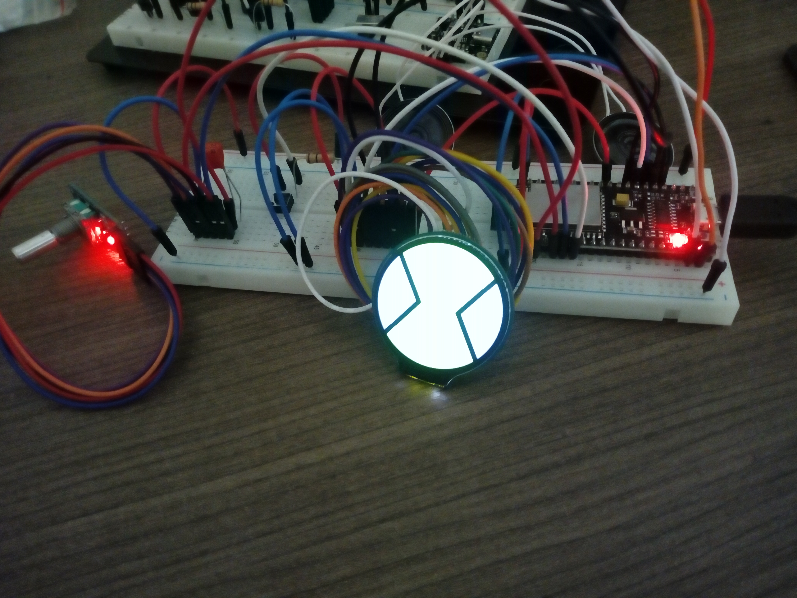
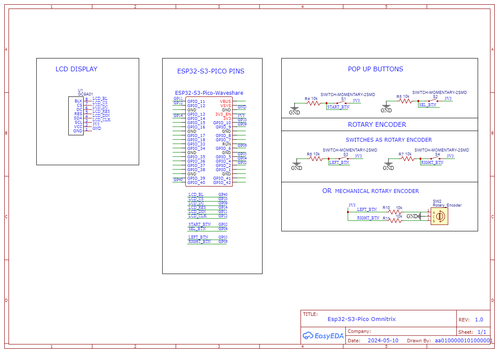

# Omnitrix

# Status
| The project now uses a Esp32-S3-Pico board. To see the version of the linked video with the [NodeMCU-32S2 module](https://www.waveshare.com/wiki/NodeMCU-32-S2-Kit) check out the [nodemcu_omnitrix_0.1.0 branch](https://github.com/AA0100000101000001/Omnitrix/tree/nodemcu_omnitrix_0.1.0) |
|----|

# Work in Progress

 


This project is meant to be a replica of the Omnitrix from the Ben 10 Classic series and be as accurate and cheap as possible. I started it to learn how to develop a mechatronic project using the ESP32. It started with a ESP32 Development Board - NodeMCU-32S2 module but I found out that there are other boards with an embedded LCD module on the market that are better to use. I decided to use ESP32-S3-Pico for now to learn how to make PCBs and rotary encoders in hopes that the size of the final Omnitrix core can be reduced. For a future version a custom PCB with LCD Display and rotary encoder can be used.   
  
In [Omnitrix-Test-Files](https://github.com/AA0100000101000001/Omnitrix-Test-Files) repository I am documenting varius tests for the features.    


Video showcasing a first test of the project with most of the features included:  

[](https://www.youtube.com/watch?v=lkjPJR9iCuw) 
  

# Instructions
These are instructions on how to use with a Esp32 Development Board to test the code. Note that the software supports different hardware to test it.     
  
You will need:  
* [Waveshare Esp32-S3-Pico](https://www.waveshare.com/wiki/ESP32-S3-Pico) or any ESP32 Development Board with PSRAM   
* [Round LCD Display GC9A01](https://www.waveshare.com/1.28inch-lcd-module.htm), I am using the [EC Buying](https://www.aliexpress.com/item/1005004786844308.html) without touch one
* Rotary Encoder OR 2X MicroSwitch SPDT ON-(ON) - Long Lever 18mm (For the rotary movement, A,B on the Schematic)  
* MicroSwitch SPDT ON-(ON) - Roller Lever (SW on the Schematic)  
* Tact Switch 6x6mm 5mm (ButtonPin on the Schematic)  
* Breadboard, jumper wires, 4X 10 kohm resistor
  
Follow the schematic on how to connect the wires.  

## Schematic:    
  

   

## Uploading The Software  
This project uses Arduino IDE to program the Esp32 so you need to [install the ESP32 board to it](https://randomnerdtutorials.com/installing-the-esp32-board-in-arduino-ide-windows-instructions/). It also uses Bodmer's [TFT_eSPI](https://github.com/Bodmer/TFT_eSPI) library for the control of the LCD Display and [PNGdec](https://github.com/bitbank2/PNGdec) for displaying png images. You can configure the LCD Display pins by editing the `libraries/TFT_eSPI/User_Setup.h` file or you can create a configuration file in `libraries/TFT_eSPI/User_Setups` folder and include it in `libraries/TFT_eSPI/User_Setup_Select.h` instead of `User_Setup.h`. I have added my configurations in the Supported Displays folder.     
```C
/* TFT_eSPI/User_Setup_Select.h */

//#include <User_Setup.h>           // Default setup is root library folder
//#include <User_Setups/Setup304_ESP32S3_GC9A01.h>
//#include <User_Setups/Setup305_ESP32S3_LCD128.h>
#include <User_Setups/Setup306_ESP32S3_PICO_GC9A01.h>
```
   
You can check the [Omnitrix-Test-Files](https://github.com/AA0100000101000001/Omnitrix-Test-Files/tree/main/Test%20files/Used%20For%20Final%20Project) repository to test the features separately before uploading the code (omnitrix folder) to the MCU. These projects are also helpfull if someone wants to use a different board.  

### User Setup
 Inside the configs folder there are some header files for the pin configuration of non LCD Display parts. You can edit the config_CUSTOM.h file for your own pin configuration or use one of other ones.  
Make sure that the pin configuration file is included in `configs.h`. In this file you can configure hardware and software settings.         
```C
/* config.h */

//Pin configuration
//Edit configs/config_DEFAULT to create your own configuration or uncomment your preferred configuration
//#include "configs/config_CUSTOM.h" //Use your own configuration
//#include "configs/config_ESP32_S3_PINOUT.h" //Esp32-s3 Dev Board
#include "configs/config_ESP32_S3_PICO_PINOUT.h" //Esp32-s3-Pico Dev Board
```
You can also remove features by commenting the `#define X_ENABLED` definitions. 
#### For hardware settings:   
The only essential features for the software to work are `POP_UP_BUTTONS_ENABLED`, one option for rotary encoder and one option for external wakeup.  
**Configuration of external wakeup:**  
Right now the EXT0_ROTARY_ENCODER configuration works with the use of the mechanical rotary encoder
```C
//WAKEUP SETTINGS: Use of ext0
//EXT0
//1. Uncomment for use of ext0
#define EXT0_ENABLED
//Choose wakeup pin and level:
#define EXT0_START_BUTTON
//#define EXT0_ROTARY_ENCODER
```
**Configuration of pop up buttons and rotary encoder:**   
(Magnetic rotary encoder is not supported yet)
```C
//POP UP BUTTONS SETTINGS: Uncomment for buttons
#define POP_UP_BUTTONS_ENABLED

//ROTARY ENCODER SETTINGS: Use one of these options for rotary encoder
//1. Uncomment for use of micro switches for encoder
//#define MICRO_SWITCHES_ROTARY_ENCODER_ENABLED
//2. Uncomment for use of mechanical encoder
#define ROTARY_ENCODER_ENABLED
//3. Uncomment for use of magnetic encoder
//#define MAGNETIC_ROTARY_ENCODER_ENABLED
```
**Configuration of sound:**  
(Buzzer is not supported yet but will be selected as the default)
```C
//SOUND SETTINGS: Uncomment for sound
//#define SOUND_ENABLED

//SOUND HARDWARE SELECTION: Use one of these options for sound
// Uncomment for use of buzzer for sound
//#define SOUND_BUZZER_ENABLED
```
**Configuration of LEDs:**  
(They are not supported yet)
```C

//LED SETTINGS: Uncomment for LEDs
//#define LEDS_ENABLED

//LED SELECTION: Use one of these options
//1. Uncomment for RGB LEDS
//#define RGB_LEDS_ENABLED
//LED 2. Uncomment for Neopixel ring LEDs
//#define NEOPIXEL_RING_LEDS_ENABLED
```
#### For software settings:  
The only essential setting is one option for the animation. Default transformation and recharging time is 60 seconds. You can configure:   

**To enable serial for debugging:**  

```C
//Basic debugging info
#define ENABLE_SERIAL

//Choose one or more types of showing specialized Serial output
//1. Verbose general info
//#define ENABLE_VERBOSE_INFO
//2. Verbose deep sleep info
//#define ENABLE_DEEP_SLEEP_INFO
//3. Info about FLASH/RAM
//#define ENABLE_MEMORY_INFO
```

**What kind of animation is being used:**  

```C
//Choose only one type of animation
//1. Start animation with images
#define START_ANIMATION_WITH_IMAGES //Has memory leaks
//2. Hard coded start animation
//#define START_ANIMATION_WITHOUT_IMAGES //Not finished
```

**If sound will be muted in booting:** 

```C
//Choose if sound will be muted in booting
//#define SOUND_MUTED_IN_BOOTING //Only if sound is enabled
```
**And if demo mode will be enabled** (sets transformation and recharge time to 10 sec)  

```C
//DEMO
//Choose if demo is enabled 
#define DEMO_ENABLED
```

## *Remember to enable PSRAM to avoid Guru Meditation Error*

## Roadmap for version 1.0.0
- [x] Update esp32 arduino core and libraries to current version
- [ ] Refactor code to look more proffesional
- [ ] Do the pending GUI updates
- [ ] Use the RGB LED of the Esp32-S3-Pico
- [ ] Add support for magnetic rotary encoder
- [ ] Add support for passive buzzer

## Dependencies
* This project is developed in Arduino IDE version 2.3.10  
* It uses the arduino-esp32 core by Espressif Systems version 3.3.12 
* TFT_eSPI library version 2.5.43  
* PNGdec library version 1.1.6  
* DFRobot_DF1201S library version 1.0.2 

# Current Features:  
* Settings for testing different hardware
* Four states of control (Start mode, Alien Selection mode, Transformation mode, Recharging Mode)
* Twelve aliens  
* Animation   
* Ability to go into Deep Sleep Mode after a short time of inactivity  
